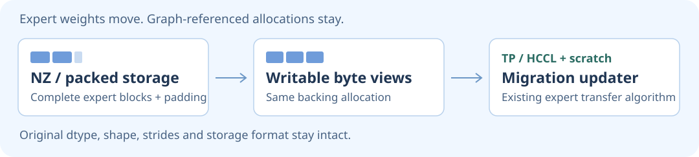

  

<b>English</b> · <a href="README.zh-CN.md">简体中文</a>

  <a href="#user-content-upstream-work">🌟 Merged work</a> &nbsp; · &nbsp;
  <a href="https://github.com/AkiYangDev/mini-deepinfer">🐋 mini-DeepInfer</a> &nbsp; · &nbsp;
  <a href="https://akiyangdev.github.io/llm-inference-notes/">📚 Engineering notes</a>

## 👋 I'm Aki

**DeepSeek inference & Ascend NPU engineering**

`SGLang` `DeepSeek` `Ascend 910C` `Ascend 950`

I contribute to **SGLang** and **sgl-kernel-npu**, building and debugging DeepSeek inference across Ascend 910C and Ascend 950 platforms.

My upstream work spans **MoE / EPLB**, prefill/decode state transfer, speculative-decoding statistics, and NPU operator correctness, with reproducible tests and serving measurements.

 

## ✅ Merged upstream work

### 🌟 Physical-storage EPLB on Ascend

**[SGLang #49701](https://github.com/sgl-project/sglang/pull/49701)** &nbsp; ✅ Merged · 2026-11-13

Reworked expert migration to move complete physical storage blocks through writable byte views, preserving NZ padding and graph-referenced allocations. Reused TP/HCCL communication and isolated draft warmup/capture from target statistics. Also covered FP4 NZ format 50 on Ascend 950PR.

**Earlier merged EPLB work:** [#47574](https://github.com/sgl-project/sglang/pull/47574) added the initial Ascend support (Nov 2); [#48751](https://github.com/sgl-project/sglang/pull/48751), opened by ch-wan, adopted my core recorder fix (Nov 6). I discovered and reported the bug in [issue #48603](https://github.com/sgl-project/sglang/issues/48603) and supplied the original fix in [#47922](https://github.com/sgl-project/sglang/pull/47922).

<picture>
  <source media="(max-width: 600px)" srcset="assets/eplb-storage-mobile.svg" />
  
</picture>

**Measured EPLB OFF → ON:** output throughput **2,648.89 → 3,627.05 token/s (+36.93%)** and mean E2E **50.49 → 36.39 s** in the documented DeepSeek-V4-Flash W8A8 PD copying workload. Mean TPOT increased from **8.85 to 10.52 ms/token**.

🔬 Experiment setup, acceptance counters & latency

The paired run at `08865d168` used Ascend 910C: 16 physical cards / 32 chips across P+D, TP16/EP16/attention-DP16 per endpoint, DSpark gamma 5 / verify 6, 16,384 input and 1,024 output tokens, concurrency 128, prefix/index caches disabled, and matched actual KV limits.

Throughput counts received generated tokens in the common **[60, 360) s** window. Latencies use successful requests started inside that window.

| Metric | EPLB OFF | EPLB ON |
| --- | ---: | ---: |
| Output throughput, token/s | 2,648.89 | 3,627.05 |
| Mean TTFT, s | 41.43 | 25.63 |
| Mean TPOT, ms/token | 8.85 | 10.52 |
| Mean E2E, s | 50.49 | 36.39 |
| Acceptance length, tokens/verify | 5.988304 | 5.988304 |
| Measured strict draft acceptance | 100% | 100% |
| Correct / proposed draft tokens, latency cohort | 658,350 / 658,350 | 908,010 / 908,010 |
| Full-run successful / failed requests | 3,072 / 0 | 3,072 / 0 |

All 3,072 paired generated texts match. ON feeds a larger observed decode batch, so the throughput gain comes with a per-request TPOT trade-off. These numbers compare EPLB OFF and ON; the PR separately reports old-ND versus physical-byte migration costs.

### More merged work

- **A3 prefill/decode state — [SGLang #47934](https://github.com/sgl-project/sglang/pull/47934)** · Nov 12  
  Fixed C4 handoff between different P/D ring sizes with row-sized registration and peer-local addressing.

- **Operator API integration — [kernel #1012](https://github.com/sgl-project/sgl-kernel-npu/pull/1012)** · Nov 10  
  Added explicit `_dsl` names across wrappers, registry, tests and bilingual docs while preserving the implementation logic.

- **DeepSeek-V4.1 operators — [kernel #964](https://github.com/sgl-project/sgl-kernel-npu/pull/964)** · Nov 9  
  Co-developed seven CANNBot-DSL compute/metadata APIs with ClownBin: dispatch contracts, Torch references, tests and K-tail storage correction.

## 🔧 Open patches

Selected open patches · state transfer, memory, precision & timing (9 PRs)

| Area | Engineering change | PR |
| --- | --- | --- |
| PD state | Preserve empty components across PP stages; use request-local C4 rows on AMD | [#47937](https://github.com/sgl-project/sglang/pull/47937) / [#47938](https://github.com/sgl-project/sglang/pull/47938) |
| Gateway lifecycle | Cancel pending prefill on early decode failure | [#49792](https://github.com/sgl-project/sglang/pull/49792) |
| Decode memory | Bound DeepSeek-V4 SWA storage by request slots | [#47740](https://github.com/sgl-project/sglang/pull/47740) |
| Numerical precision | Preserve Softplus accuracy in GDN gating and decode | [kernel #933](https://github.com/sgl-project/sgl-kernel-npu/pull/933) |
| Sparse attention | Exclude padded lanes from non-power-of-two TopK reduction | [kernel #935](https://github.com/sgl-project/sgl-kernel-npu/pull/935) |
| Quantization | Preserve AWQ fallback dtype; correct GPTQ zero-point offsets | [#47639](https://github.com/sgl-project/sglang/pull/47639) / [#47637](https://github.com/sgl-project/sglang/pull/47637) |
| Benchmark timing | Record non-streaming PD decode handoff time | [#47772](https://github.com/sgl-project/sglang/pull/47772) |

Open status checked on 2026-11-14. Each link carries the latest upstream state.

📦 More open SGLang patches (12 PRs)

- [#47721 · Bound DeepSeek-V4 RoPE tables by serving context](https://github.com/sgl-project/sglang/pull/47721) · Open
- [#47720 · Bound DeepSeek-V4 prefill query intermediates](https://github.com/sgl-project/sglang/pull/47720) · Open
- [#47718 · Release temporary DeepSeek-V4 RoPE tables](https://github.com/sgl-project/sglang/pull/47718) · Open
- [#47713 · dsv4: Reuse verify sequence lengths](https://github.com/sgl-project/sglang/pull/47713) · Open
- [#47665 · dsv4: Generate compression positions with stepped arange](https://github.com/sgl-project/sglang/pull/47665) · Open
- [#47663 · dsv4: Reuse CPU query lengths for prefill metadata](https://github.com/sgl-project/sglang/pull/47663) · Open
- [#47659 · MLA: preserve NZ cache data during CPU retraction](https://github.com/sgl-project/sglang/pull/47659) · Open
- [#47656 · moe: Honor SwiGLU clamp for BF16 and INT8 experts](https://github.com/sgl-project/sglang/pull/47656) · Open
- [#47654 · sparse-kv: Preserve shared prefixes in physical host slots](https://github.com/sgl-project/sglang/pull/47654) · Open
- [#47647 · dsv4: Avoid unused packed indexer cache allocation](https://github.com/sgl-project/sglang/pull/47647) · Open
- [#47634 · attention: Slice MLA latent K after TP all-gather](https://github.com/sgl-project/sglang/pull/47634) · Open
- [#47629 · moe: honor simple TopK scoring and routing scale](https://github.com/sgl-project/sglang/pull/47629) · Open

📦 More open NPU operator patches (8 PRs)

- [#936 · include dtypes in legacy add RMSNorm cache key](https://github.com/sgl-project/sgl-kernel-npu/pull/936) · Open
- [#934 · compute weightless RMSNorm in float32](https://github.com/sgl-project/sgl-kernel-npu/pull/934) · Open
- [#932 · normalize strided gating inputs](https://github.com/sgl-project/sgl-kernel-npu/pull/932) · Open
- [#930 · preserve tiling configurations across graph replays](https://github.com/sgl-project/sgl-kernel-npu/pull/930) · Open
- [#926 · include sparse attributes in the tiling cache key](https://github.com/sgl-project/sgl-kernel-npu/pull/926) · Open
- [#925 · handle cache-location windows larger than 16 tokens](https://github.com/sgl-project/sgl-kernel-npu/pull/925) · Open
- [#924 · handle fully masked leading tiles in argmax probability](https://github.com/sgl-project/sgl-kernel-npu/pull/924) · Open
- [#922 · preserve arch22 accumulation order across batch sizes](https://github.com/sgl-project/sgl-kernel-npu/pull/922) · Open

## 🐋 Projects & engineering notes

### [mini-DeepInfer](https://github.com/AkiYangDev/mini-deepinfer)

A runnable teaching inference engine built around DeepInfer's execution design: scheduling, batching, KV-slot reclamation and speculative decoding, from CPU examples to real Qwen3.5 generation on Ascend 910C.

### [LLM Inference Notes](https://akiyangdev.github.io/llm-inference-notes/)

Chinese articles connecting upstream code, reproducible examples and measured behavior. Recent writing:

- [Physical-storage EPLB migration](https://akiyangdev.github.io/llm-inference-notes/articles/performance/ascend-eplb-physical-storage-migration/) — padding, scratch, lifetime and update costs.
- [Graph capture and tensor storage](https://akiyangdev.github.io/llm-inference-notes/articles/performance/graph-capture-tensor-storage/) — changing weights while preserving captured addresses.
- [Proving expert migration correct](https://akiyangdev.github.io/llm-inference-notes/articles/performance/eplb-weight-migration-correctness/) — bytes, quantization scales, mapping and fixed-state forward checks.

   
  <b>Inference, kernels, and a well-reproduced bug. Let's talk 🐋</b> 
  DeepSeek whale girl · Community fan art

